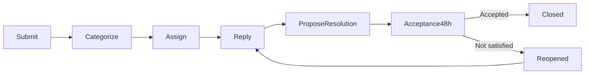
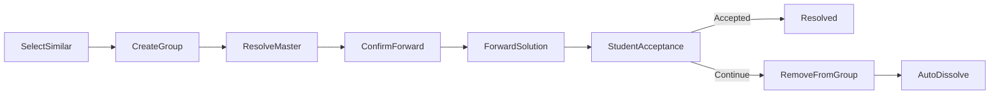
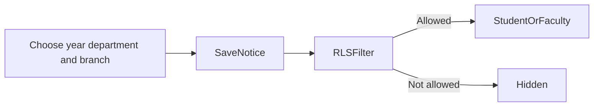
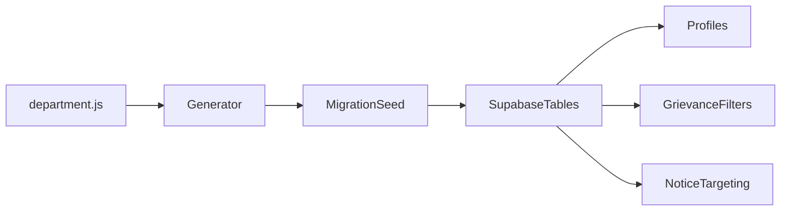

# ExGrev Implementation Progress

- **Current branch:** `version3-new`
- **Date:** 2026-11-20
- **Last updated:** 2026-11-20

## 1. Overview and branch information

This branch continues the Grievance Portal for Student, Teaching Staff, and Examination Cell roles. It adds department/branch canonical data, targeted notice audiences, and a complete grouped-grievance filter/data model while preserving the existing header, footer, session timer, and role workspaces.

## 2. Roles and permissions matrix

| Capability | Student | Faculty | Exam Cell |
|---|---|---|---|
| Submit grievance | Yes | No | No |
| View own/assigned/all cases | Own | Assigned | All |
| Add remarks | Own thread participant | Assigned case | Yes |
| Manage grouped filter/groups | No | No | Yes |
| Create/edit notices | No | No | Yes |
| View targeted notices | Matching year/department/branch | Matching department/all departments | All |
| Manage guidelines | No | No | Yes |

## 3. Workflow diagrams

### Grievance lifecycle


### Grouped-grievance flow


### Targeted notice flow


### Department data flow


## 4. Feature-by-feature explanation

- **Authentication:** existing Supabase login and profile restoration remain in place.
- **Category/sub-category:** submission categories remain unchanged; `__grouped__` is a separate virtual filter.
- **Grouping:** Exam Cell can create, edit, dissolve, forward, and audit groups. Similar-group filtering remains inside the three grievance views.
- **Notices:** audiences may target year, department, and branch. Empty arrays mean all.
- **Guidelines:** all-department visibility remains the default.
- **Exam filters:** search, department, branch, study year, status, category, date range, pagination, and URL state are combined.
- **Department source:** `src/department.js` is the frontend source of truth.
- **Enrollment rule:** `BTCB25O1116` has admission year 2025 from characters 5-6 and maps `CB` to Computer Science & Engineering. Academic year starts in August and is capped at four study years.

## 5. Database

Main tables and additions:
- `departments`, `branches`
- `notices`: `target_years`, `target_departments`, `target_branches`
- `guidelines`: department/branch targeting columns
- `grievance_groups`: solution and forwarding/audit fields
- `grievance_group_members`: removal and forwarding timestamps
- `grievance_group_events`

Key functions include `student_study_year`, `student_department_code`, `list_grievances_for_exam_cell`, group management RPCs, and `student_group_status`.

Storage remains in private notice/guideline buckets with signed URLs and targeted RLS.

Migration order includes every existing migration followed by `202611210001_department_targeting_and_group_audit.sql`.

## 6. Frontend

- Role pages: `src/pages/StudentPage.jsx`, `TeachingStaffPage.jsx`, `examinationCell.jsx`
- Shared navigation: `src/components/PortalNavigation.jsx`
- Grievance services: `src/services/grievanceService.js`
- Content service: `src/services/portalContentService.js`
- Department model: `src/department.js`
- Enrollment helpers: `src/lib/enrollment.js`

## 7. Run and deploy

```powershell
cd exgrev
npm ci
npm test
npm run lint
npm run build
npm run dev
```

Generate department seed SQL:
```powershell
npm run generate:department-seed
```

In Supabase, apply migrations filename order, deploy the Edge Functions, configure environment variables, and verify RLS with Student, Faculty, and Exam Cell accounts.

### Supabase Dashboard checklist
- [ ] Run migrations in filename order, including `202611210001_department_targeting_and_group_audit.sql`.
- [ ] Confirm `departments` and `branches` have 11 departments and 18 branches.
- [ ] Confirm notice targeting columns and the `grievance_group_events` table exist.
- [ ] Assign the Exam Cell, Faculty, and Student roles through the existing profile data.
- [ ] Test RLS/storage by direct signed-in queries for each role.

### VS Code / terminal checklist
- [ ] Run `npm ci`.
- [ ] Copy `.env.example` to `.env.local` and set the Supabase URL/key.
- [ ] Run `npm run generate:department-seed` after department.js changes.
- [ ] Run `npm test`, `npm run lint`, and `npm run build`.
- [ ] Commit and push only after live Supabase role tests pass.

## 8. Test checklist

- [x] Department helper tests
- [x] Enrollment year/boundary tests
- [x] Frontend build
- [ ] Direct Supabase RLS role tests
- [ ] Live notice attachment audience tests
- [ ] Live grouped-grievance forwarding tests
- [ ] Live branch filter tests

## 9. Changelog

- **2026-11-20:** Added department/branch helpers, migration seed, notice targeting fields/UI, grouped virtual filter support, group audit tables/RPC foundations, and this progress record.

## 10. Known limitations and next steps

- Supabase role behavior must be verified live because no credentials were available in this workspace.
- Full visual management dialogs for add/remove/rename/dissolve should be exercised against the deployed RPCs.
- The branch seed and drift script should be run whenever `department.js` changes.
- Existing unmapped free-text department/branch values are not deleted and require dashboard review.
